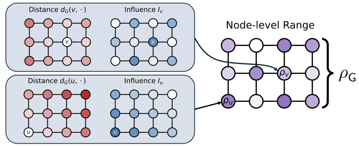

# On Measuring Long-Range Interactions in Graph Neural Networks



Official Repository for the ICML 2025 paper ["On Measuring Long-Range Interactions in Graph Neural Networks"](https://arxiv.org/abs/2506.05971), which formalises and analyses the existence of long-range interactions by in Graph Neural Networks and their respective benchmarks, through a novel **range measure**.

Based on code from [1] and [2].


### Setup
```bash
conda create --name longrange python=3.9 -y
conda activate longrange

DEVICE="cu118"  # "cpu", "cu118"

pip install torch==2.0.0 torchvision==0.15.1 torchaudio==2.0.1 --index-url https://download.pytorch.org/whl/$DEVICE
python -c "import torch; print(f'\nCUDA available: {torch.cuda.is_available()}\n')"

pip install torch_geometric==2.3.0
pip install torch_scatter torch_sparse torch_cluster torch_spline_conv -f https://data.pyg.org/whl/torch-2.0.0+$DEVICE.html

pip install -r requirements_additional.txt

pip install -e .
```
Test the venv setup with `bash tests/test_repo.sh` (it will take a little while to run).

# Synthetic experiments
All scripts for running the synthetic experiments can be found in [scripts/synthetic_exps.sh](scripts/synthetic_exps.sh). All the results and data for the plots can be found in the [data/plotting](data/plotting/) folder. The scripts to generate the plots can be found in [notebooks/plotting_synthetic.ipynb](notebooks/plotting_synthetic.ipynb).

# LRGB experiments
The following code block:
- Trains models on LRGB tasks from according to hyperparameters from [1] (additional details explained in paper)
- Generates scripts to compute the range measure across models/tasks/splits/epochs
- Collates the results and plots the figures found in the paper

```
bash scripts/train_models.sh # can be time consuming; only required once

python scripts/generate_lrgb_scripts.py # add `--slurm` flag to additionally generate slurm scripts

notebooks/figures/plot_ranges_peptides.py
notebooks/figures/plot_ranges_voc.py
```
You will likely have to tweak the above for your configuration.

**N.B.** the important args for LRGB experiments are those described in `lrgb_exps/graphgps/config/longrange.py` (especially `longrange.track_range_measure True`, which ensures that dataset features required for calculating the range are computed) and `train.mode eval_range`, which switches from default model *training* to range calculation once model state checkpoints have been saved.

# Additional datasets
- Cora -> [scripts/camera-ready/cora.sh](scripts/camera-ready/cora.sh)
  

# Citing this paper
If you utilised our code for your work or project please consider citing our paper: 

```bibtex:
@inproceedings{bambergermeasuring,
  title={On Measuring Long-Range Interactions in Graph Neural Networks},
  author={Bamberger, Jacob and Gutteridge, Benjamin and le Roux, Scott and Bronstein, Michael M and Dong, Xiaowen},
  booktitle={Forty-second International Conference on Machine Learning}
}
```
# References
[1] https://github.com/benfinkelshtein/CoGNN

[2] https://github.com/toenshoff/LRGB
